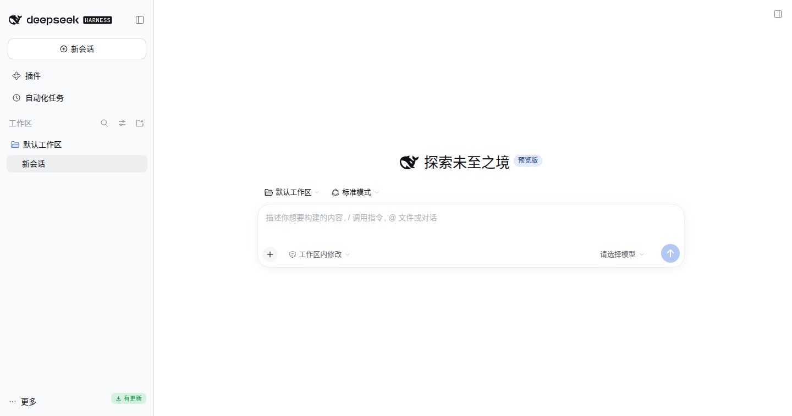
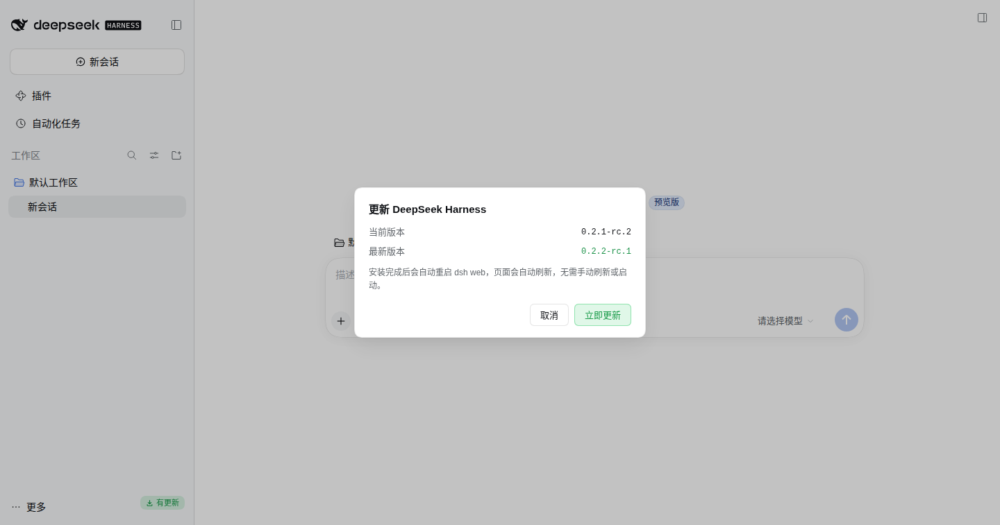
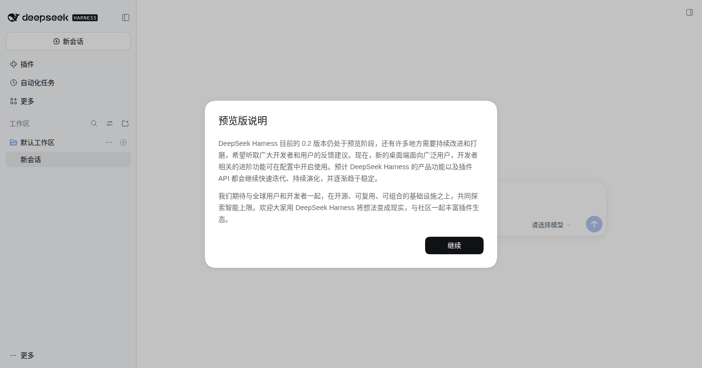

# dsh-web-update

<p align="center"></p>

<p align="center">
  <a href="https://www.npmjs.com/package/dsh-web-update"></a>
  <a href="LICENSE"></a>
  
</p>

One-click updater for **DeepSeek Harness Web** on Linux. It checks npm for a newer `@deepseek-ai/dsh` at startup and every 24 hours, shows a small light-green badge at the right edge of your account row when an update exists, and — after one confirmation — installs the release and restarts `dsh web` by itself. The page reloads itself into the new version.

给 **Linux 上的 DeepSeek Harness Web（`dsh web`）** 加一个一键更新入口：启动时和之后每 24 小时检查 npm 上的新版本，有更新时在侧边栏底部「头像 + 用户名」那一行右侧显示一个淡绿色小徽标；点开可查看当前/最新版本并二次确认，确认后自动安装并重启 `dsh web`，页面自动刷新到新版本，无需手动启动或刷新。



## Features

- **Auto check** — one check shortly after `dsh web` starts, then every 24 hours while it keeps running (configurable).
- **Only when needed** — the badge appears only when npm publishes a version newer than the running one. No badge, no noise.
- **Light-green badge, native placement** — a 20px pill at the right edge of the account row (`sidebar.footer.action` slot, anchored to the measured sidebar foot), theme-aware for light and dark.
- **One click, one more confirmation** — the dialog shows the running version and the published version, and asks before doing anything.
- **Real install** — runs `npm install -g @deepseek-ai/dsh@<latest>` with the npm that owns the running installation.
- **Automatic restart** — a detached bash helper waits for the old process to exit, waits for the port to be released, starts the exact same command line, and only reports success when the new process is alive *and* accepting TCP connections. It never leaves `dsh web` stopped.
- **Automatic rollback** — if the new version does not come up, the helper reinstalls the previous version and starts it again.
- **No manual refresh** — after the restart the page reloads itself once the new Host answers; the white screen that a stale client release would otherwise cause is handled. ([details](#why-the-page-used-to-go-white))
- **Never runs unauthenticated** — every API route passes the Host connection's browser-trust fence (origin/host admission + signed browser cookie).



## Requirements

| | |
|---|---|
| DSH | `dsh web`, **Linux** (the restart helper uses `/bin/bash` and bash's `/dev/tcp`; macOS is untested) |
| Installation | `@deepseek-ai/dsh` installed by **npm globally** (package under `<prefix>/lib/node_modules/@deepseek-ai/dsh`) |
| Runtime | Node.js **>= 22**; `npm` on `PATH` (or set `npmCommand`) |
| Not supported | the Desktop (Electron) app, source checkouts, `pnpm`/`yarn` installs — the update button reports why instead of guessing |
| Host composition | a `dsh web` host with the **Connection** service enabled (the trust fence); without it the routes fail closed with 503 |

Tested with `@deepseek-ai/dsh` **0.2.1-rc.2 → 0.2.2-rc.1** on Linux.

## Install

**1. From the Web UI (recommended)** — open **插件 (Plugins) → 添加插件 (Add plugin)**, enter the npm spec `dsh-web-update`, and install. The plugin manager adds the package dependency *and* selects the bundle, so no manual config is needed.

**2. From a DSH session** — ask the agent to run the plugin manager for the target directory:

```
plugin_manager install_bundle target=dsh-web-update
```

**3. Manually** — `pnpm add` alone only installs the dependency, it does not activate the bundle:

```sh
dsh plugin --profile web add dsh-web-update
# then add "dsh-web-update" to dsh.profile.bundles in ~/.dsh/profiles/web/package.json
```

After installing, reload the page once so the browser loads the plugin's client half.

## Why the page used to go white

An upgrade replaces the whole client release, so the open page keeps the release it booted from while the new Host serves another one. DSH intentionally pauses applying the new plugin graphs until the page reloads — and the page does not reload by itself, so it could end up blank until a manual refresh.

This plugin ships a module-level watchdog (owned by the plugin context, not by the React tree, so it keeps running even when the app root is empty). It compares `window.__DSH_BOOT__.release.version` with the Host's `/state.currentVersion`; when they differ and the new Host answers, it reloads the page once. A `sessionStorage` guard caps attempts per Host release, so it can never reload in a loop.

| Before (stale page stays blank) | After (auto-reloads into the new version) |
|---|---|
|  |  |

## How it works

```
dsh web (Host)                                    browser (Client)
├── index.js  ── routes /dsh-web-update/{state,check,update}
│               registry check, npm install,      ├── client.js
│               restart helper                    │   ├── badge + confirm dialog
├── host/update.js  version + registry + npm       │   └── auto-refresh watchdog
└── host/restart.js detached bash helper          └── polls /state (1.2s … 60s)
```

1. **Check** — `GET /dsh-web-update/state` returns the running version (detected from the process's own package), the version behind the npm dist-tag, and whether it is newer.
2. **Install** — `POST /dsh-web-update/update` spawns `npm install -g …`, streams the log tail into the dialog, then verifies the installed `package.json` really reports the target version.
3. **Restart** — the Host writes a bash helper, starts it **detached in its own session**, and exits. The helper waits for the old pid, waits for the port to be free, replays `process.execPath + argv` (adding `--no-open`, so no extra tab opens), and succeeds only when the new process is alive and the port accepts connections.
4. **Rollback** — if that check fails, the helper reinstalls the previous version and starts it again. The outcome is written to `last-restart.json` and the log.
5. **Refresh** — the browser page notices the Host release changed and reloads once.

## Configuration

Optional, in the profile's `cordis.patch.yml` (`~/.dsh/profiles/web/cordis.patch.yml`). Every key is optional:

```yaml
- id: dsh-web-update
  name: 'dsh-web-update'
  config:
    checkIntervalHours: 24      # periodic check while dsh web keeps running
    autoCheckOnStart: true      # one check after activation
    registryUrl: https://registry.npmjs.org
    packageName: '@deepseek-ai/dsh'
    distTag: latest             # e.g. next for another channel
    npmCommand: ''              # empty = the npm next to the running dsh install
    installArgs: null           # full argument template; {target} is replaced
    restartTimeoutSeconds: 90   # budget for the new server to become healthy
    allowPrereleaseUpdates: true
```

`installArgs` defaults to `[install, -g, --no-audit, --no-fund, {target}]`. For a custom npm prefix, e.g.:

```yaml
    installArgs: ['install', '-g', '--prefix', '/custom/prefix', '--no-audit', '--no-fund', '{target}']
```

## Files and logs

| Path | Content |
|---|---|
| `$DSH_HOME/dsh-web-update/update.log` | npm output plus every restart-helper step |
| `$DSH_HOME/dsh-web-update/last-restart.json` | outcome of the last restart: `restarted` / `rolled-back` / `failed` |
| `$DSH_HOME/dsh-web-update/restart-dsh-web.sh` | the generated helper script (rewritten per update) |

## Security

- All three routes reject untrusted hosts, cross-site requests and unauthenticated browsers: the Host connection fence returns **401/403** before any handler runs. Only same-origin, signed-cookie requests can trigger an install.
- The fence is the **only** admission path: if the `connection` service (or its `requestRejection`) is missing, the routes **fail closed with 503** and a one-time warning is logged when the first such request is refused. There is deliberately no weaker local fallback, so a local process without the browser cookie cannot start an install on a shared machine.
- The installed package name comes from the plugin config (default `@deepseek-ai/dsh`); no user input is interpolated into a shell string — npm runs as an argument array, and the restart helper is a generated file with shell-quoted constants.
- No credentials are read: the restart keeps the existing browser-session cookie secret (`$DSH_HOME/.credentials.yaml`) untouched, so open pages stay authenticated.

## FAQ / troubleshooting

- **npm prints `install-scripts … not yet covered by allowScripts`** — that is an npm notice, not a failure. Install scripts still run by default (`strict-allow-scripts` is off); the update result and the restart health check decide success.
- **“当前 dsh 不是 npm 全局安装”** — the running `dsh` is not a global npm install (source checkout, `pnpm -g`, …). The plugin refuses to update instead of installing elsewhere. Update with the tool that installed it.
- **`dsh web` under systemd / a container** — the helper starts its own process; your supervisor may also restart one, so prefer the supervisor's restart path in that deployment.
- **Need to roll back manually** — `npm install -g @deepseek-ai/dsh@1.0.0` style: run `npm install -g @deepseek-ai/dsh@<version>` and reload the page.
- **`lastRestart` is `null` right after a restart** — the freshly started Host may read the status file before the helper writes it; the log is authoritative.

## Verified

- Runtime: badge geometry against the account row at 1440×757 (right edge 4px inside the row, vertically centered), light and dark themes, confirm/installing/restarting/updated dialog states.
- Restart helper: real processes cover plain restart, detached survival after the parent exits, and rollback when the new server never starts.
- End-to-end in an isolated npm prefix (`/tmp`, its own `DSH_HOME`, port elsewhere): real `npm install -g @deepseek-ai/dsh@0.2.2-rc.1` → automatic restart → new process on the same command line → `/state` reports the new version → the page reloaded itself once and came back healthy. The real serving process and the user's global install were not touched.
- End-to-end inside a throwaway Docker container that plays a real user's machine (npm-global `dsh web` on the old version, plugin installed from its packed npm tarball): badge → confirm dialog → real install → detached restart helper → auto page refresh into `0.2.2-rc.1`, with exactly one reload and no refresh loop. The host's dsh version, global package, profile and running server were byte-for-byte unchanged afterwards.
- Trust fence: unauthenticated `GET /state` and `POST /update` return 401; a cross-site `POST` returns 403.

## Development

No build step — the client half is plain JavaScript served as a module.

```sh
npm test        # node:test — version comparison, install-arg expansion, restart-script quoting
npm pack --dry-run
```

Repo layout: `index.js` (Host entry), `client.js` (browser module), `host/*.js` (version/registry/restart helpers), `cordis.patch.yml` (bundle row), `locale/` (plugin metadata), `icon.svg` (+ `assets/*.png` storefront tiles), `docs/` (screenshots).

## License

[MIT](LICENSE)
